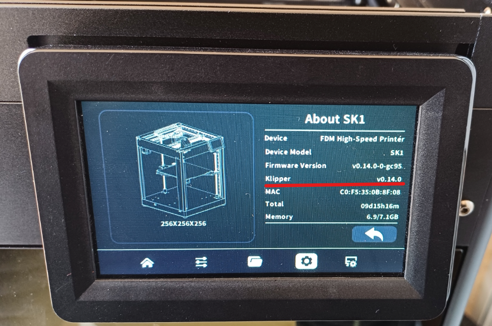

# sk1-alt-mksclient-screen



**Keep the built-in TwoTrees SK1 touchscreen working with current releases of Moonraker and Klipper.** This replacement host client talks to the SK1's factory LKS TJC display over UART and to Moonraker over its JSON-RPC WebSocket API. It discovers the Klipper objects available on the printer and renews its subscriptions after reconnecting.

The client supports the factory LKS display firmware and the amber panel project reconstructed from it. The separate custom HMI in the [sk1-hmi project](https://github.com/azizvc/sk1-hmi) uses a different serial map. This repository contains the host client, tests, and protocol documentation.

## Compatibility

| Klipper | Moonraker | Verification |
|---|---|---|
| `v0.14.0-0-gc9559fa-dirty` | `0.11.0` (API `1.5.0`) | Live probe on a TwoTrees SK1. The printer reported ready, the client subscribed to 10 Klipper objects, and Moonraker returned the G-code file list. |
| `v0.10.0-530-g3387a9c23-dirty` | `v0.7.1-609-gbdd0222-dirty` (API `1.0.5`) | Earlier probe on the reference SK1. |

The probe exercises the Moonraker connection without a serial port. See the [validation plan](docs/LKS-VALIDATION.md) for touchscreen and hardware workflows that still need physical testing.

## Install on the printer

Use this procedure on a TwoTrees SK1 with the factory LKS touchscreen or a compatible LKS panel project. Start with the printer idle and connect over SSH as `mks`. For example, run `ssh mks@printer-ip` from your computer, replacing `printer-ip` with the printer's IP address. Run the remaining commands in the SSH session. The included service uses `/dev/ttyS1` at 115200 baud and connects to Moonraker at `http://127.0.0.1:7125`.

### 1. Install the client and check Moonraker

The printer needs Git, Python 3.7 or later with working `venv` and `pip`, and network access to GitHub and PyPI. Use an empty installation directory for these steps.

```sh
sudo install -d -o "$(id -un)" -g "$(id -gn)" /opt/mksclient-alt
git clone https://github.com/azizvc/sk1-alt-mksclient-screen.git /opt/mksclient-alt
cd /opt/mksclient-alt
python3 -m venv .venv
.venv/bin/python -m pip install .
.venv/bin/mksclient-alt --probe --moonraker http://127.0.0.1:7125
```

Check that the probe reports your Moonraker and Klipper versions and that the printer state is `ready` before handing the screen over to the new service. If Moonraker requires an API key, set `MKSCLIENT_ALT_API_KEY` in the SSH session before running the probe. For the systemd service, put the same variable in `/etc/mksclient-alt.env` and restrict that file to root with permissions `0600`.

### 2. Switch the touchscreen service

Identify the active display client and record whether it starts at boot. The factory service is typically `makerbase-client.service`. An SK1 with the separate custom HMI may use `sk1-hmi.service`.

```sh
systemctl list-units --type=service --all | grep -E 'makerbase-client|sk1-hmi|mksclient-alt'
systemctl list-unit-files --type=service | grep -E 'makerbase-client|sk1-hmi|mksclient-alt'
```

If another display service is active, stop that specific unit before starting the new client. For example, run `sudo systemctl stop makerbase-client.service` only if that unit exists and is active. If you get `Unit makerbase-client.service not loaded`, your SK1 uses a different unit or has no previous display service. If the UART is busy and neither example matches, run `sudo fuser -v /dev/ttyS1` if `fuser` is available to identify the process holding the port.

Run these commands from `/opt/mksclient-alt`.

```sh
sudo install -m 0644 packaging/mksclient-alt.service /etc/systemd/system/mksclient-alt.service
sudo systemctl daemon-reload
sudo systemctl start mksclient-alt.service
sudo systemctl status mksclient-alt.service --no-pager
sudo journalctl -u mksclient-alt.service -n 50 --no-pager
```

Check that the screen shows live temperatures and opens the local file list. The touchscreen controls are enabled by default. The `dialout` group grants UART access in the included service. Wi-Fi controls also require the `mks` user to have access to the wpa_supplicant control socket.

Once the screen responds, enable the new service at boot. The first check should report `enabled`, and the second should report `active`.

```sh
sudo systemctl enable --now mksclient-alt.service
systemctl is-enabled mksclient-alt.service
systemctl is-active mksclient-alt.service
```

If an existing previous display service was enabled at boot, disable that specific unit to keep both clients from opening the UART after a reboot. If the screen stops working after reboot, check the current boot log with `sudo journalctl -b -u mksclient-alt.service --no-pager`.

### Optional read-only mode

Printer controls work with the default service configuration. Use read-only mode to keep temperatures, progress, and files visible while blocking printer commands from the screen.

To enable read-only mode, create or edit the optional file with `sudoedit /etc/mksclient-alt.env` and add `--read-only` to `MKSCLIENT_ALT_ARGS`. If the value already contains `--enable-controls`, remove that flag before adding `--read-only`.

```ini
MKSCLIENT_ALT_ARGS="--read-only"
```

Apply the change with `sudo systemctl restart mksclient-alt.service`.

### Restore the previous screen client

If the new client fails to start or the screen does not respond, run `sudo systemctl disable --now mksclient-alt.service`. If this installation replaced a display service, start that specific unit again. If it had been enabled at boot, restore that setting with `sudo systemctl enable <previous-service>`, substituting its actual unit name.

## Network

The Network page shows the IPv4 address in the footer and lists four Wi-Fi networks per page. The arrows change pages and the refresh button starts a new scan. Tap the current network for its status or another network to open the **Connect** dialog. A keyboard appears for WPA/WPA2 Personal networks.

Switching Wi-Fi can change the printer's IP address. The client saves the new configuration after association and IPv4 assignment. If the connection fails, it attempts to restore the previous profile. Wi-Fi setup works independently of the printer controls.

Use `--display-ip` to override the footer address and `--wifi-socket` to select the local wpa_supplicant socket, which defaults to `/run/wpa_supplicant/wlan0`. The service user needs access to that socket. [wpa_supplicant control interface](https://w1.fi/wpa_supplicant/devel/ctrl_iface_page.html)

## Files and printing

The Home and Print pages show current and target temperatures. The Print page also shows progress, elapsed time, and remaining time estimated from progress. The file browser navigates G-code directories, reads metadata, and retrieves print history through Moonraker.

Under **Files → Local**, embedded PNG and JPEG thumbnails are converted to ColPic and sent in blocks to `cp0`, `cp1`, and `cp2` on page 7. The client handles touches between blocks and cancels a pending transfer when the page changes. To disable thumbnails, pass `--no-thumbnails` or set `MKSCLIENT_ALT_DISABLE_THUMBNAILS=1`. [SK1 UART reference](https://github.com/vap-tech/twotrees-sk1-display/blob/main/display_uart_raw_protocol.md)

System, homing, and calibration workflows depend on the capabilities of the printer's Klipper configuration. See the [LKS protocol](PROTOCOL.md), [event catalog](docs/LKS-EVENTS.csv), and [validation plan](docs/LKS-VALIDATION.md) for coverage and outstanding hardware checks.
